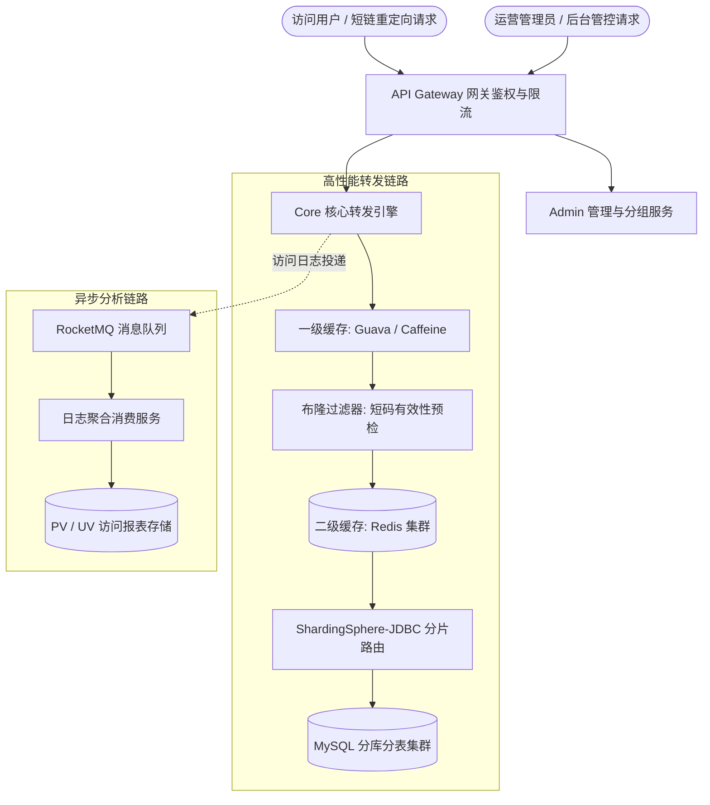
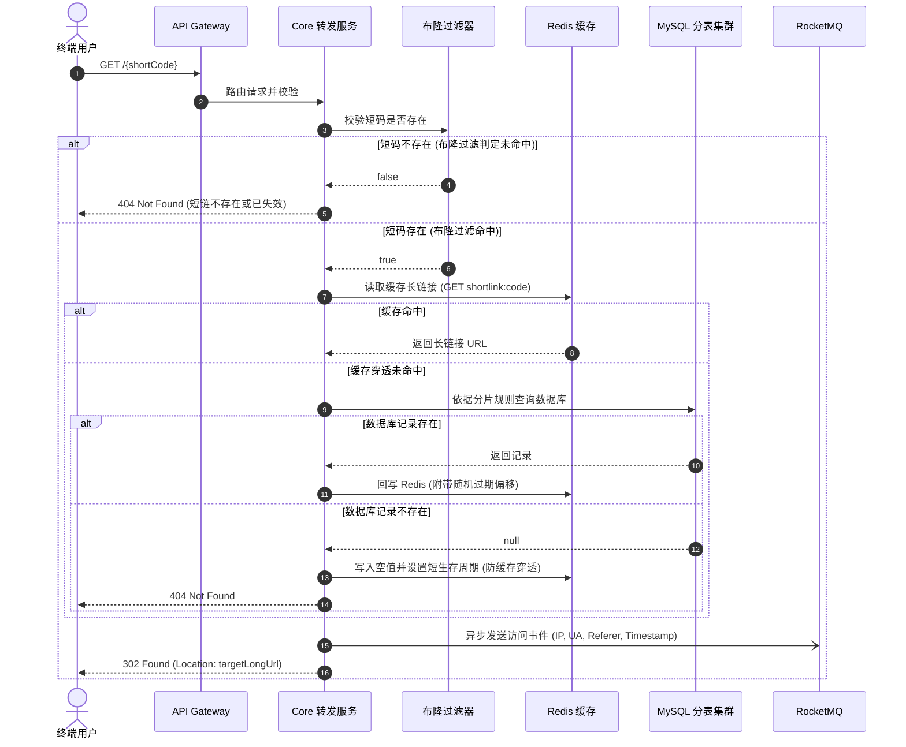

# shortlink

> 基于 Spring Boot 3 与微服务架构的高并发分布式短链接系统，提供高性能分布式发号、布隆过滤器防穿透、302 实时重定向与异步日志分析能力。

[](#)
[](https://www.oracle.com/java/)
[](https://spring.io/projects/spring-boot)
[](https://spring.io/projects/spring-cloud)
[](https://shardingsphere.apache.org/)
[](https://redis.io/)
[](https://rocketmq.apache.org/)
[](LICENSE)



---

## 目录
- [核心架构与设计选型](#核心架构与设计选型)
- [业务时序与状态流转](#业务时序与状态流转)
- [核心发号算法与容量估算](#核心发号算法与容量估算)
- [分库分表与存储模型](#分库分表与存储模型)
- [工程目录拓扑](#工程目录拓扑)
- [环境基线与前置要求](#环境基线与前置要求)
- [配置与环境变量字典](#配置与环境变量字典)
- [本地构建与运行验证](#本地构建与运行验证)
- [核心接口协议规范](#核心接口协议规范)
- [防御机制与边界安全](#防御机制与边界安全)
- [开源协议与技术支持](#开源协议与技术支持)

---

## 核心架构与设计选型

本系统将高并发短链重定向（读密集型）与短链生成及后台管控（写密集与业务管理）解耦，核心选型策略如下：

1. **重定向协议选型 (302 临时重定向)**：
   - 301 永久重定向会被浏览器强制本地持久缓存，后续点击直接在终端跳转，服务层无法捕获访问时序与设备上下文。
   - 302 临时重定向强制每次访问回源解析，由网关与服务层捕获请求来源、IP、User-Agent 等元数据，保障全量 PV、UV 及地域画像的精确统计。
2. **多级缓存架构**：
   - 一级缓存采用进程内缓存（Caffeine/Guava），处理突发高频热点短码。
   - 二级缓存采用 Redis Cluster 存储短码与原始长链接映射，配合 Redisson 分布式布隆过滤器拦截非法探测。
3. **分库分表路由**：
   - 底层接入 Apache ShardingSphere-JDBC 5.3.2，采用水平分表应对海量短链存储与并发检索压力。
4. **日志削峰解耦**：
   - 采用 RocketMQ 异步传输访问明细，避免统计写操作阻塞重定向主链路，确保接口响应时间稳定在毫秒级。

---

## 业务时序与状态流转

### 短链重定向流转时序



---

## 核心发号算法与容量估算

### 1. 短码编码体系
系统采用 Base62 字符集（`0-9`, `a-z`, `A-Z`），避免出现 URL 敏感字符（如 `+`、`/`、`?`、`&`）：

$$\text{Base62 Charset} = [0-9, a-z, A-Z] \quad (\text{基数 } N = 62)$$

当短码长度设为 6 位时，总编码空间容量为：

$$62^6 = 56,800,235,584 \approx 568 \text{ 亿}$$

当短码长度设为 7 位时，总编码空间容量为：

$$62^7 = 3,521,614,606,208 \approx 3.52 \text{ 万亿}$$

对于日均生成千万级短链的生产系统，6 位编码足以支撑 10 年以上的业务发展，且具备高压缩比特性。

### 2. 发号方案与冲突防御
- **雪花算法 (Snowflake ID) + Base62**：
  采用分布式唯一 64-bit ID 生成器生成全局递增序列，将其转换为 62 进制字符串。为避免被连续遍历爬取，发号后结合固定散列位打散。
- **MurmurHash3 + 冲突探测重试**：
  对长 URL 进行 MurmurHash3_32 运算得到 32-bit 哈希值转 Base62。为应对极小概率哈希碰撞，入库时利用长短链唯一复合索引检测冲突；一旦触发碰撞，自动追加固定随机盐重新哈希并完成递增重试。

---

## 分库分表与存储模型

数据层采用两张核心逻辑表实现短链的高效写入、更新与读跳转路由：

### 1. 短链信息表 (`t_link`)
负责存储短链的映射主体、完整元数据与生命周期控制。

| 字段名 | 类型 | 说明 | 索引策略 |
| :--- | :--- | :--- | :--- |
| `id` | `bigint(20)` | 分布式主键 ID | 主键索引 |
| `gid` | `varchar(32)` | 业务分组标识 | 联合索引 (`gid`, `create_time`) |
| `full_short_url` | `varchar(128)` | 完整短链接 (域名+短码) | 唯一索引 (`full_short_url`, `del_flag`) |
| `origin_url` | `varchar(1024)` | 原始长链接 | 普通索引 |
| `click_num` | `int(11)` | 点击累积总量 | 辅助监控 |
| `valid_date_type` | `tinyint(1)` | 有效期类型 (0: 永久, 1: 自定义) | - |
| `valid_date` | `datetime` | 失效截止时间 | 扫描索引 |
| `describe` | `varchar(128)` | 链接描述 | - |
| `del_flag` | `tinyint(1)` | 逻辑删除标记 (0: 正常, 1: 已删除) | 唯一索引分量 |

### 2. 分片路由策略
- **分表键选型**：由于 99% 的请求属于“短码重定向”读请求，系统将 `full_short_url` 的 Hash 码作为核心分表路由键，确保重定向流量均匀命中单一数据分片，避免跨库跨表广播查询。
- **管理端维度适配**：管理端依业务分组（`gid`）检索短链列表时，通过冗余关联索引表解决异构分片键查询开销。

---

## 工程目录拓扑

```text
shortlink
├── admin                                  # 运营后台与短链管理服务 (RESTful API, 分组, 权限)
│   ├── src/main/java/com/robao/shortlinkadmin/
│   │   └── ShortlinkAdminApplication.java # 管理模块主启动类
│   ├── src/main/resources/
│   │   └── application.properties         # 管理服务运行时配置
│   └── pom.xml                            # 模块依赖声明
├── gateway                                # API 网关服务 (路由转发、鉴权、全局限流)
│   ├── src/main/java/com/robao/shortlinkgateway/
│   │   └── GatewayApplication.java        # 网关主启动类
│   ├── src/main/resources/
│   │   └── application.properties         # 网关运行时配置
│   └── pom.xml                            # 网关模块依赖声明
├── .env.example                           # 环境变量与机密配置模版
├── .gitignore                             # Git 排除规范
├── LICENSE                                # Apache 2.0 许可证
├── pom.xml                                # 父工程 Maven 依赖与模块版本管控
└── 短链接项目思考与总结.md                 # 架构思考与业务设计沉淀
```

---

## 环境基线与前置要求

| 组件名称 | 最低版本要求 | 推荐配置 | 用途说明 |
| :--- | :--- | :--- | :--- |
| **JDK** | 17 (LTS) | Temurin OpenJDK 17.0.8+ | 核心运行时，启用 ZGC / G1GC 垃圾收集器 |
| **Maven** | 3.8.0+ | 3.9.x | 依赖构建与多模块统一打包 |
| **MySQL** | 8.0.28+ | 8.0+ (InnoDB, UTF8MB4) | 关系型持久化存储、分库分表基座 |
| **Redis** | 7.0+ | Standalone / Cluster | 短链二级缓存、Redisson 布隆过滤器 |
| **RocketMQ** | 5.1.0+ | 5.x 存算分离架构 | 访问明细异步解耦与削峰消费 |

---

## 配置与环境变量字典

系统遵循云原生 12-Factor 原则，生产环境配置通过环境变量动态注入。本地运行参考物理文件 [.env.example](.env.example)。

| 环境变量名 | 说明 | 默认值 / 示例值 | 是否必填 |
| :--- | :--- | :--- | :--- |
| `SERVER_PORT` | HTTP 监听端口 | `8001` | 否 |
| `SPRING_DATASOURCE_URL` | MySQL 数据库连接串 | `jdbc:mysql://127.0.0.1:3306/shortlink?useUnicode=true&characterEncoding=UTF-8` | 是 |
| `SPRING_DATASOURCE_USERNAME` | 数据库用户名 | `root` | 是 |
| `SPRING_DATASOURCE_PASSWORD` | 数据库访问密码 | `******` | 是 |
| `SPRING_DATA_REDIS_HOST` | Redis 连接主机地址 | `127.0.0.1` | 是 |
| `SPRING_DATA_REDIS_PORT` | Redis 服务端口 | `6379` | 否 |
| `SPRING_DATA_REDIS_PASSWORD`| Redis 授权密码 | `******` | 否 |
| `ROCKETMQ_NAME_SERVER` | RocketMQ NameServer 集群地址 | `127.0.0.1:9876` | 是 |
| `ROCKETMQ_PRODUCER_GROUP` | 访问日志生产者事务组 | `shortlink_log_producer_group` | 否 |

---

## 本地构建与运行验证

### 1. 编译构建
在项目根目录下执行 Clean 与 Package：

```bash
# 全局多模块构建（跳过测试）
mvn clean package -DskipTests
```

### 2. 启动核心服务
分别启动网关与对应微服务模块：

```bash
# 启动 Gateway 网关服务
java -jar gateway/target/gateway-0.0.1-SNAPSHOT.jar

# 启动 Admin 管理服务
java -jar admin/target/shortlink-admin-0.0.1-SNAPSHOT.jar
```

### 3. 健康检查验证
服务启动后，验证端口监听与健康检查断点响应：

```bash
# 验证 Admin 模块探活端点
curl -i -X GET http://127.0.0.1:8001/actuator/health
```

---

## 核心接口协议规范

接口交互遵循 RESTful 规范，数据载荷统一采用 `application/json;charset=UTF-8`。

| 请求方式 | 路由路径 | 接口描述 | 核心入参 / 返回格式 |
| :--- | :--- | :--- | :--- |
| `POST` | `/api/short-link/v1/create` | 创建单条短链接 | `{"originUrl":"https://...", "gid":"xxx", "validDateType":0}` |
| `POST` | `/api/short-link/v1/create/batch` | 批量生成短链接 | `{"originUrls":["https://..."], "gid":"xxx"}` |
| `GET` | `/{shortCode}` | 短链 302 实时重定向 | 路径传参 `shortCode`，响应标头 `Location: targetUrl` |
| `POST` | `/api/short-link/v1/update` | 更新短链元数据或有效期 | `{"fullShortUrl":"...", "originUrl":"...", "describe":"..."}` |
| `POST` | `/api/short-link/v1/recycle-bin/recover`| 恢复回收站短链 | `{"fullShortUrl":"...", "gid":"xxx"}` |
| `GET` | `/api/short-link/v1/stats` | 获取短链监控统计指标 | `fullShortUrl=...&startDate=...&endDate=...` |

---

## 防御机制与边界安全

1. **缓存击穿与穿透治理**：
   - 采用 Redisson 分布式布隆过滤器（容错率预设为 0.1%），拦截非本系统生成的随机伪造短码请求。
   - 数据库未命中时，对不存在的短码在 Redis 中缓存短生存周期的空键（TTL: 30-60s），阻断恶意扫描直接打穿至底层数据库。
2. **缓存雪崩防御**：
   - 短链缓存过期时间引入动态扰动范围（基础 TTL + 随机 1~10 分钟偏移量），避免大规模营销活动短链同一时刻批量失效。
3. **域名合规与长链安全性检测**：
   - 长链接输入前校验网络协议合法性（限制 `http://` 与 `https://`）。
   - 内置域名黑白名单机制，过滤内网探测 IP（如 `127.0.0.1`、`192.168.0.0/16`、`10.0.0.0/8`）与欺诈风险域名。
4. **Non-Goals 边界声明**：
   - 本系统核心职责为短链解析、分发与访问指标采集，不承担下游目标业务站点的流量清洗、DDoS 抵御与内容合规审查。

---

## 开源协议与技术支持

本项目遵循 [Apache License 2.0](LICENSE) 开源许可证。
欢迎提交 Issue 交流缺陷排查与架构优化建议，提交代码请遵循规范的 Git Commit 消息格式。
